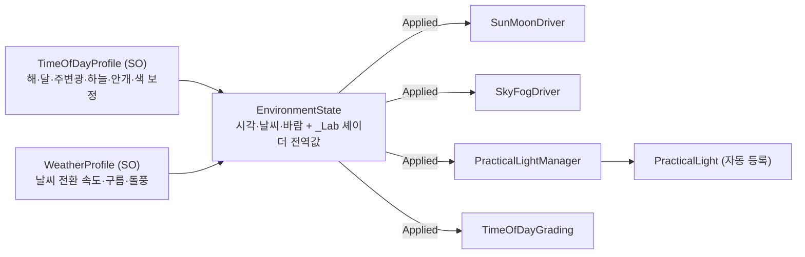

# 프로젝트 규칙 (재사용 구조)

이 프로젝트는 배경 제작에 자주 쓰는 기술을 **기능별로 따로 구현하고, 다른 환경 프로젝트에 그대로 옮겨 쓸 수 있게** 만드는 것을 목표로 한다.
이 문서는 그 재사용 구조의 규칙이다. 리팩터링 단계(R0~R5)는 아래 "로드맵"에 있다.

## 1. 폴더 구조

```txt
Assets
└─ PixelArtLab                      다른 프로젝트로 복사하는 단위
   ├─ Runtime                       재사용 코어 (PixelArtLab.Runtime)
   │  ├─ Core                       렌더러 기능, 레이어, 공용 렌더 유틸
   │  ├─ PixelCamera                픽셀 버퍼·격자 스냅·서브픽셀 보정
   │  ├─ Linework                   물체 ID 선화
   │  ├─ Shading                    조정한 법선, Sprite Toon 키워드 동기화
   │  ├─ Environment                시간대·날씨·바람·강수·생활 조명
   │  ├─ Water                      웅덩이·평면 반사·발 파문
   │  ├─ Snow                       눈 발자국
   │  ├─ Visibility                 캐릭터 가림 해소
   │  ├─ Atmosphere                 픽셀 볼류메트릭
   │  └─ Character                  예제 캐릭터 이동 (R3에서 기능과 분리 예정)
   ├─ Shaders                       SH_ 셰이더 + 기술별 HLSL 모듈 (Lab*.hlsl)
   ├─ Presets                       기본 프로필 (SO_TimeOfDay_Default, SO_Weather_Default)
   ├─ Editor                        재사용 에디터 도구 (PixelArtLab.Editor)
   │  ├─ Setup                      URP 파이프라인 설정
   │  ├─ Shading                    Sprite Toon 인스펙터·키워드 일괄 동기화
   │  └─ Tools                      프로젝트 점검 도구
   ├─ Settings                      프로젝트 공통 렌더 설정 (RP_, RD_)
   └─ Samples                       이 프로젝트 전용 예제 (다른 프로젝트로 옮기지 않음)
      ├─ Runtime                    예제 게임플레이·비교 조작 (PixelArtLab.Samples)
      ├─ Editor                     씬 생성·검증·단계 적용 스크립트 (PixelArtLab.Samples.Editor)
      └─ Settings                   Woodland 전용 프로필 (SO_TimeOfDay_Woodland, VP_)
```

- 씬(`Assets/Scenes`), 아트(`Assets/Art`), 외부 에셋(`Assets/ThirdParty`)은 예제 콘텐츠다. 씬 생성 스크립트가 경로 문자열로 참조하므로 R0에서는 옮기지 않았다(R4에서 기술별 테스트 씬과 함께 정리).
- `Docs`와 `Previews`는 저장소 루트에 둔다.

## 2. 어셈블리 (asmdef)

| 어셈블리 | 위치 | 참조 | 플랫폼 |
| --- | --- | --- | --- |
| `PixelArtLab.Runtime` | Runtime | URP Core·Universal Runtime | 전체 |
| `PixelArtLab.Editor` | Editor | Runtime | Editor |
| `PixelArtLab.Samples` | Samples/Runtime | Runtime | 전체 |
| `PixelArtLab.Samples.Editor` | Samples/Editor | Runtime, Samples, Editor | Editor |

- **참조는 안쪽으로만 간다.** Samples → Runtime은 되지만 Runtime → Samples는 안 된다. 그래서 Runtime 폴더만 다른 프로젝트에 복사해도 컴파일된다.
- 네임스페이스는 `PixelArtLab`(런타임), `PixelArtLab.Editor`(에디터)다.

## 3. 이름 규칙

새로 만드는 에셋부터 적용한다. 기존 예제 아트 에셋 이름은 씬 생성 스크립트가 참조하므로 R4에서 함께 바꾼다.

| 접두사 | 종류 | 예 |
| --- | --- | --- |
| `SH_` | 셰이더 파일 | `SH_SpriteToon` |
| `Lab*.hlsl` | 셰이더 기술 모듈 | `LabSnow.hlsl` |
| `MAT_` | 머티리얼 | `MAT_Lantern_Glass_Warm` |
| `TEX_` | 텍스처 | `TEX_ForestGround_Diff` |
| `PFB_` | 프리팹 | `PFB_Lantern_Post` |
| `SO_` | ScriptableObject 프리셋 | `SO_TimeOfDay_Woodland` (R1) |
| `VP_` | URP Volume 프로필 | `VP_Woodland_Grade_Night` |
| `RP_` | 렌더 파이프라인 에셋 | `RP_PixelArtLab_PC` |
| `RD_` | 렌더러 데이터 | `RD_PixelArtLab_PC` |

- 셰이더 전역값과 재질 속성은 `_Lab` 접두사를 쓴다(예: `_LabEnvironment`, `_LabHeightFog`). 다른 셰이더와 이름이 겹치지 않게 하기 위해서다.
- 메뉴는 `Pixel Art Lab/…` 아래에 둔다.

## 4. 레이어

| 번호 | 이름 | 용도 |
| --- | --- | --- |
| 4 | Water | Unity 기본 레이어. 반사 촬영에서 제외 |
| 8 | Character | 플레이어 몸체. 지면 탐색에서 제외 |
| 13 | Effects | 강수 입자·파문·발자국. 반사와 지면 탐색에서 제외 |

- 코드는 숫자를 직접 쓰지 않고 `PixelArtLab.LabLayers`를 쓴다. 다른 프로젝트에서 레이어 번호가 다르면 이 파일만 고친다.
- 이름은 `Project Settings > Tags and Layers`에 설정한다.

## 5. 환경 코어 (R1)



| 구성 | 역할 | 필수 |
| --- | --- | --- |
| `EnvironmentState` | 시각·날씨·바람·애니메이션 시간을 갖고, 하늘 값(Daylight, Dusk 등)을 계산해 셰이더 전역값을 보낸다 | O |
| `TimeOfDayProfile` | 시간대별 색·세기·안개·색 보정 프로필. 아트 방향마다 하나 | 선택 (없으면 기본값) |
| `WeatherProfile` | 비·눈 전환 속도, 젖음·마름, 구름·돌풍 영향 | 선택 (없으면 기본값) |
| `SunMoonDriver` | 방향광 하나를 해·달로 움직이고 색·세기를 바꾼다 | 선택 |
| `SkyFogDriver` | 카메라 배경색과 Unity 거리 안개 | 선택 |
| `PracticalLightManager` | 모든 `PracticalLight`의 밝기·일렁임과 가까운 N개 그림자 | 선택 |
| `TimeOfDayGrading` | 프로필의 색 보정 Volume 5개를 실행 중에 만들어 해에 따라 섞는다(씬에 저장되지 않음) | 선택 |

- 기능은 `EnvironmentState.Applied` 이벤트로 연결된다. `Apply()` 한 번이면 모든 드라이버가 함께 바뀐다.
- `PracticalLight`는 켜지면 스스로 등록된다. 씬마다 조명 목록을 관리하지 않는다.
- 이 프로젝트의 `WorldEnvironment`는 이제 **Samples 쪽 얇은 연결부**다. 데모 단축키(F1~F4, 1~3, L, B, V, U)와 예전 API만 남겼다.
- 예전 씬은 `Pixel Art Lab > Environment > Migrate Sample Scenes`로 옮겼다(값은 그대로 유지).

## 6. 셰이더 모듈 (R2)

Sprite Toon은 이제 기술 모듈을 **조합만 하는** 셰이더다. 모듈은 각각 다른 URP 셰이더에 단독으로 include할 수 있다.

| 모듈 | 기술 | 주요 함수 | 입력 |
| --- | --- | --- | --- |
| `LabEnvironment.hlsl` | 환경 전역값 | `LabCloudShade`, `LabEmissiveMask` | EnvironmentState |
| `LabWind.hlsl` | 나무·풀·깃발·물결 정점 움직임 | `LabDeformVertex` | 렌더러별 `_LabWindParams` (WorldSurfaceMotion) |
| `LabToonLighting.hlsl` | 4단 툰 조명, 그림자 색, GGX 하이라이트, Built-in식 점광 감쇠 | `LabSunLight`, `LabLocalLight`, `LabLegacyAttenuation` | `LabToonSurface` |
| `LabWetness.hlsl` | 비에 젖은 표면 | `LabWetAlbedo`, `LabWetSheen` | wetness |
| `LabSnow.hlsl` | 위쪽 면에 쌓이는 눈 | `LabSnowAlbedo` | snowCover |
| `LabPuddles.hlsl` | 웅덩이·젖은 흙·빗방울 파문·반사 합성 | `LabApplyPuddles`, `LabPuddleReflect` | wetness, `_Puddles` |
| `LabPlanarReflection.hlsl` | 평면 반사 투영 | `LabPuddleReflectionUV`, `LabWaterReflectionUV` | DetailWaterReflection |
| `LabWater.hlsl` | 호수 법선·반짝임·물가 거품·프레넬 반사 | `LabWaterNormal`, `LabWaterGlint`, `LabWaterReflection` | 노멀맵, 물가 타원 |
| `LabHeightFog.hlsl` | 높이 안개, 안개 속 등불 번짐 | `LabApplyHeightFog` | TimeOfDayProfile |
| `LabCharacterLight.hlsl` | 캐릭터 림·반사광 | `LabCharacterLight` | PlayerVisibility |
| `LabVisibility.hlsl` | 캐릭터 앞 가림막 디더 구멍 | `LabVisibilityClip` | PlayerOccluder |

**키워드 규칙**

- 머티리얼 단위 기능은 `shader_feature_local` 키워드로 넣는다. 쓰지 않는 머티리얼에는 코드가 컴파일되지 않는다.

  | 키워드 | 켜지는 조건 |
  | --- | --- |
  | `_LAB_ALPHACLIP` | `_AlphaClip` 켬 (잎 잘라내기) |
  | `_LAB_NORMALMAP` | `_NormalMap` 텍스처 있음 |
  | `_LAB_PACKED_ARM` | `_UsePackedARM` 켬 |
  | `_LAB_SEMIREAL` | `_SemiPBR` > 0 |
  | `_LAB_PUDDLES` | `_Puddles` > 0 |
  | `_LAB_WATER` | `Water surface` 켬 |

- 키워드는 값에서 정해진다(`SpriteToonKeywords.Sync`). 인스펙터는 자동으로 맞추고, 코드로 값을 바꿨으면 `Sync`를 부른다. 전체 재동기화는 `Pixel Art Lab > Materials > Sync Sprite Toon Keywords`.
- **렌더러 단위 스위치는 키워드로 만들지 않는다.** 바람 종류, 캐릭터 조명, 가림 구멍은 MaterialPropertyBlock으로 공유 머티리얼에 렌더러마다 다르게 주기 때문에 uniform 분기로 둔다. 키워드는 머티리얼 전체에만 걸 수 있다.
- 키워드가 켜져도 값 검사는 남긴다(예: `_LAB_PUDDLES` 안에서 `_Puddles > .001`). 키워드는 "컴파일할지", 값은 "얼마나"를 정한다. 그래서 검증 코드가 값만 0으로 바꿔도 결과가 맞다.
- 비교용 전역 스위치(`_LabDetailedToon`, `_LabNormalDisabled`, `_LabReflectionDisabled`, `_LabContinuous`)는 실행 중 전환용이라 키워드가 아니다.

## 7. 다른 프로젝트로 옮기는 방법

1. `Assets/PixelArtLab`에서 `Runtime`, `Shaders`, `Editor`, `Settings`, `Presets`를 복사한다(`Samples`는 제외).
2. URP 17.3 패키지를 설치하고 `Pixel Art Lab > Set Up PC URP`를 실행한다.
3. 레이어 4/8/13을 비워 두거나 `LabLayers`를 그 프로젝트 번호로 바꾼다.
4. 환경 오브젝트에 `EnvironmentState`와 필요한 드라이버를 붙이고, 프로필을 지정하거나 `Create > Pixel Art Lab > Environment`로 새로 만든다.
5. 머티리얼을 가져왔다면 `Pixel Art Lab > Materials > Sync Sprite Toon Keywords`를 실행한다.
6. `Pixel Art Lab > Tools > Check Missing Scripts`로 누락 스크립트를 확인한다.

자체 셰이더에서 기술 하나만 쓸 때는 해당 `Lab*.hlsl`을 include하고 함수를 부르면 된다. 예: 눈만 필요하면 `#include "LabSnow.hlsl"` 후 `albedo=LabSnowAlbedo(albedo,normalWS,0);`. 전역값은 `EnvironmentState`가 보낸다.

현재 한계(이후 단계에서 해결):
- 발자국·파문·가림 해소·캐릭터 정렬이 예제 캐릭터(`ExplorerMotor`)에 의존한다 → R3
- 물가 거품 타원(`_LabWaterBounds`) 기본값이 예제 호수 위치다 → R3
- 강수 입자에 예제 호수 위치가 박혀 있다 → R3

## 8. 로드맵

| 단계 | 내용 | 상태 |
| --- | --- | --- |
| R0 | 폴더·어셈블리·이름 규칙·레이어 정리 | 완료 |
| R1 | 환경 코어 분리, 시간대·날씨 프로필 SO | 완료 |
| R2 | Sprite Toon 기능별 모듈·키워드 분리 | 완료 |
| R3 | 기능 컴포넌트·프리셋, Volume 기반 설정, 예제 의존 제거 | 예정 |
| R4 | 기술별 테스트 씬과 검증 | 예정 |
| R5 | Notion 정리 | 예정 |
