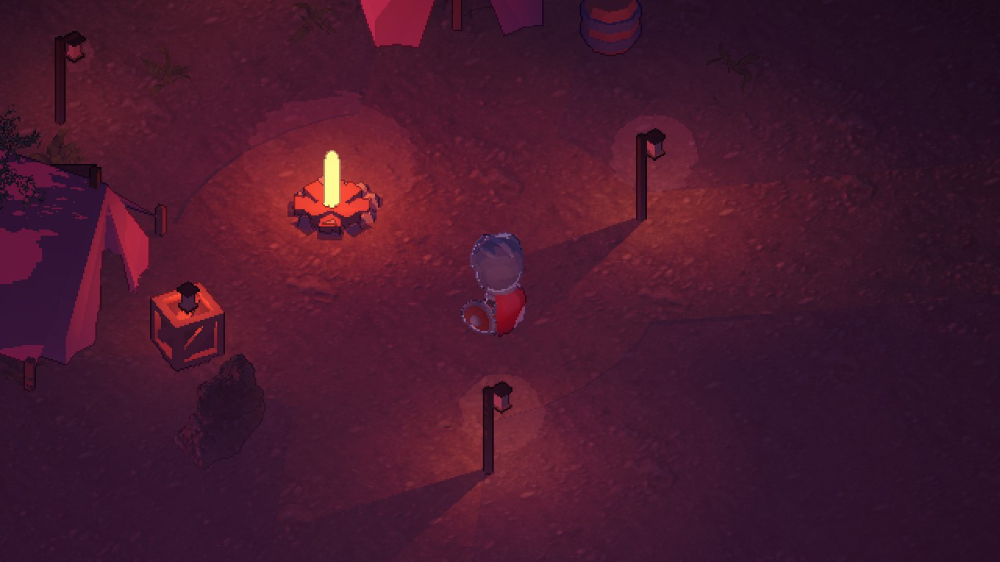
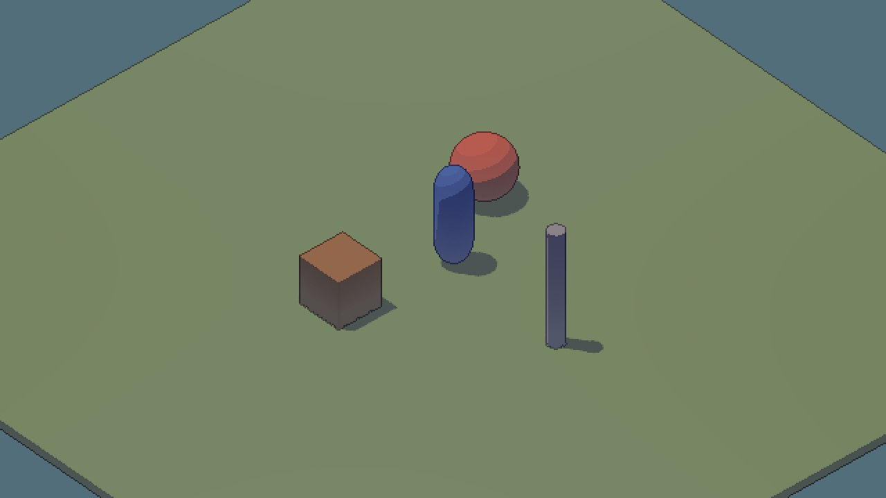
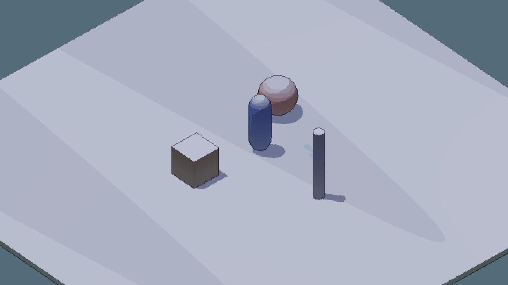
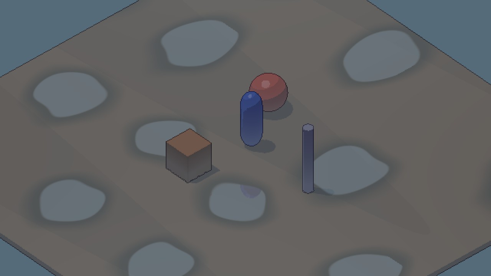
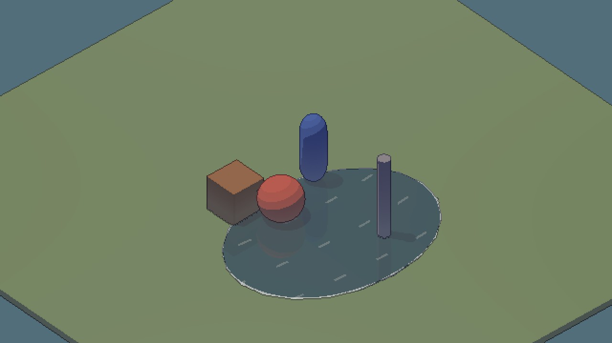
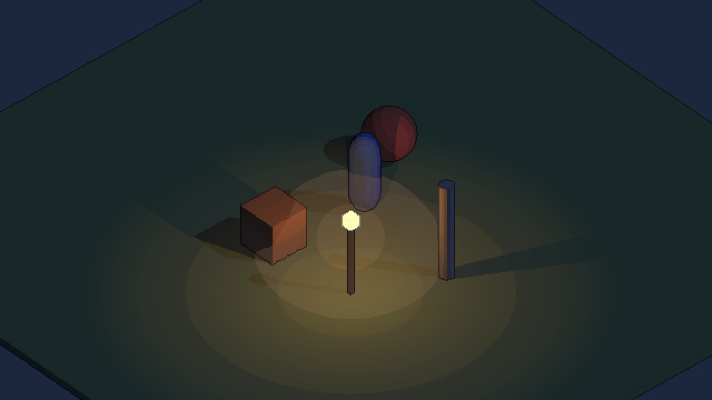

# 🎚 3. 설정값 사전

룩을 바꾸는 값은 세 곳에 있습니다. **에셋(SO)** · **컴포넌트** · **머티리얼**. 셰이더 코드는 고치지 않아도 됩니다.
새 스타일은 Project 창 우클릭 `Create > Pixel Art Lab > Style`로 만들고 `SurfaceStyleSet`의 칸에 끼웁니다. 칸이 비면 기본값이 들어갑니다.

## 🔎 빠른 찾기

| 하고 싶은 것 | 바꿀 곳 |
|---|---|
| 지금 시각 · 날씨 | `EnvironmentState` → `hour` · `weather` |
| 노을 · 밤 색 | `TimeOfDayProfile` → 해·달 색, 안개 색, 색 보정 볼륨 |
| 비 · 눈이 오는 속도 | `WeatherProfile` → `rainRate` · `snowRate` |
| 더 빨리 마르게 | `WeatherProfile` → `dryRate` |
| 명암 단계를 더 많이 / 적게 | `ToonRampStyle` → `bandStarts` · `bandLevels` |
| 그림자 색 | 머티리얼 `Shadow Hue` |
| 눈 색 · 쌓이는 경사 | `SnowStyle` |
| 웅덩이 간격 · 위치 높이 | `PuddleStyle` → `cellSize` · `minimumHeight` |
| 물 반짝임 · 거품 | `WaterStyle` |
| 캐릭터 테두리 빛 | `CharacterLightStyle` · `PlayerVisibility` |
| 등불 일렁임 | `PracticalLight` → `flicker` · `flickerRate` |
| 구역마다 안개 다르게 | URP Volume에 `Pixel Art Lab/Pixel Atmosphere` 추가 |
| 선 굵기 · 진하기 | `PixelLinework` · `PixelArtObject` |
| 픽셀 크기 | `ExplorationCamera` → `pixelsPerUnit` |

---

## 🕒 시간대 · TimeOfDayProfile

`Create > Pixel Art Lab > Environment > Time Of Day Profile`

| 그룹 | 값 | 느낌 |
|---|---|---|
| Sun · Moon | 색 · 세기 | 해 · 달빛. 노을에는 주홍 · 분홍 해 색이 따로 있음 |
| Ambient | 낮 · 밤 · 흐림 주변광 | **그림자 쪽 밝기와 색**. 밤에 너무 어두우면 여기 (`nightAmbient` .1) |
| Sky · Distance fog | 하늘색 · 거리 안개 | 카메라 배경색과 먼 곳 안개 |
| Height Fog | 높이 · 감쇠 · 낮밤 밀도 · 흐름 | 물가와 낮은 곳에 고이는 안개 |
| Dusk Fog | 주홍 · 분홍 · 보라 | 노을 안개 색 |
| Grades | Day · DuskVermilion · DuskPink · DuskViolet · Night | 색 보정 Volume 5개 (해 높이로 섞임) |

## 🌧 날씨 · WeatherProfile

| 값 | 기본 | 추천 · 주의 |
|---|---|---|
| `rainRate` · `snowRate` | .45 · .40 /초 | 올리면 비 · 눈이 빨리 시작하고 그침 |
| `wetRate` · `dryRate` | .25 · .025 /초 | 젖는 속도의 1/10로 마르면 비 그친 뒤 여운이 남음 |
| `snowCoverMax` | .95 | 1이면 경사면까지 하얗게 덮임 |
| `snowAccumulateRate` · `snowMeltRate` | .065 · .035 | |
| `rainCloud` · `snowCloud` | .8 · .65 | 구름 그늘 양 |
| `cloudScale` · `cloudSpeed` | (.085, .11) · (.04, .03) | 구름 그늘 크기 · 이동 속도 |

---

## 🌗 ToonRampStyle

| 값 | 기본 | 느낌 |
|---|---|---|
| `bandStarts` | .16 / .48 / .78 | 빛이 이 값을 넘으면 다음 단계 |
| `bandLevels` | 0 / .48 / .82 / 1 | 네 단계 밝기. 간격이 좁으면 부드럽고, 넓으면 그래픽적 |
| `litTint` | 따뜻한 흰색 | 밝은 쪽 색조 |
| `directStrength` | .65 | 직사광 세기. 낮추면 그림자 쪽 색이 더 드러남 |
| `cloudDimming` | .35 | 구름 그늘이 해를 가리는 정도 |
| `leafTransmission` | .14 | 뒤에서 잎을 통과하는 빛 |

## ❄️ SnowStyle

| 값 | 기본 | 추천 · 주의 |
|---|---|---|
| `color` | 푸른 흰색 | 그림자가 보라면 눈도 살짝 푸르게 |
| `slopeStart` | .20 | 0이면 수직 벽 바로 위부터, .5면 평평한 곳에만 |
| `slopeSharpness` | 1.6 | 높을수록 눈 경계가 또렷 |
| `steps` | 4 | **3~5 추천**. 많을수록 부드럽고 도트 느낌이 약해짐 |
| `stepBias` | .2 | 단계를 위쪽으로 올림 |

## 🌧 WetnessStyle

| 값 | 기본 | 추천 |
|---|---|---|
| `darkening` | .17 | .1 ~ .25. 너무 높으면 밤처럼 어두워짐 |
| `sheenSize` | .975 | 높을수록 하이라이트가 작음 |
| `sheenStrength` | .12 | |

## 💧 PuddleStyle

| 값 | 기본 | 추천 · 주의 |
|---|---|---|
| `cellSize` | 6 m | 웅덩이 간격. 바꾸면 발 물튀김 판정도 같이 바뀜 |
| `minimumHeight` | .38 m | 이 높이 아래는 웅덩이 없음 (호숫가 물과 겹치지 않게). 평지 씬은 낮추기 |
| `dampTint` · `dampRoughness` | 푸른 회색 · .28 | 웅덩이 주변 젖은 흙 |
| `poolReflection` · `grazingReflection` | .55 · .25 | 반사 세기 · 비스듬히 볼 때 추가 |
| `ringDensity` · `ringSpeed` · `ringStrength` | 1.3 · 1.25 · .08 | 빗방울 파문 |

> 머티리얼마다 `Puddles`를 켜야 그 표면에 웅덩이가 생깁니다. 지면 · 길에만 켭니다.

## 🌊 WaterStyle

| 값 | 기본 | 느낌 |
|---|---|---|
| `glintColor` | 옥색 | 반짝임 · 거품 색 |
| `glintStrength` · `rainRingStrength` · `foamStrength` | .4 · .24 · .65 | |
| `normalTiling` | .18 | 물결 노멀 반복 (1m당) |
| `fresnelBase` · `fresnelGrazing` | .12 · .75 | 위에서 본 반사 · 비스듬한 반사 |
| `nightReflection` | .35 | 밤 반사 비율 |

물가 모양은 `WaterBody`의 `center` · `radii` (타원), 빗방울이 떨어지는 높이는 `surfaceHeight`.

## 🧍 CharacterLightStyle · PlayerVisibility

| 값 | 기본 | 느낌 |
|---|---|---|
| `rimDay` · `rimNight` | 따뜻한 노랑 · 푸른 하늘색 | 테두리 빛 |
| `rimThreshold` · `rimLevel` | .62 · .6 | 테두리 폭 · 밝기 |
| `bounceDay` · `bounceNight` | | 아래에서 올라오는 반사광 |
| `rimStrength` · `bounceStrength` (PlayerVisibility) | .32 · .12 | 캐릭터별 세기 |

---

## 🏮 PracticalLight

| 값 | 기본 | 추천 |
|---|---|---|
| `nightIntensity` · `dayIntensity` | 2.5 · 0 | 횃불은 낮에도 켜 두려면 dayIntensity 2 |
| `flicker` | .25 | 0 ~ .3. 전기등은 0 |
| `flickerRate` | 8 | 초당 변화 횟수 (계단식) |
| `wobble` | .02 m | 불꽃 위치 흔들림 |

## 🌫 PixelVolumetrics · PixelAtmosphere (Volume)

| 값 | 기본 | 느낌 |
|---|---|---|
| `airDensity` | .01 | 공기 전체 밀도 |
| `sunStrength` · `moonScatter` | .08 · .25 | 해 빛줄기 · 해가 진 뒤 달빛 비율 |
| `lampStrength` · `lampGlowReach` | .15 · .6 | 등불 빛무리 세기 · 범위 (낮에는 25%) |
| `bandStep` | .035 | 밝기 단계. 0이면 부드러움 |
| `heightFogDensity` (Volume만) | 1 | 시간대 안개에 곱하는 배율 |
| `heightFogLift` (Volume만) | 0 m | 안개가 짙은 높이를 올림 |

> Volume은 **체크한 값만** 덮어씁니다. 체크하지 않은 값은 카메라와 시간대 값을 그대로 씁니다.

## 🟫 ExplorationCamera · ✏️ PixelLinework

| 값 | 기본 | 느낌 |
|---|---|---|
| `sourceHeight` | 360 | 버퍼 세로 해상도 |
| `pixelsPerUnit` | 25 (Woodland 40) | 1m당 텍셀. 높을수록 디테일 |
| `strength` (선화) | .78 | 선 진하기 |
| `depthThreshold` · `normalThreshold` | .16 · .32 | 깊이 · 법선 차이 선 |
| `interior` · `silhouette` (PixelArtObject) | .25 · 1 | 물체별 안쪽 · 바깥 선 |

## 머티리얼 (Sprite Toon)

| 칸 | 느낌 |
|---|---|
| `Paint Color` · `Shadow Hue` | 기본 색 · 그림자 색 |
| `Semi-real shading blend` | 0 툰 ↔ 1 반실사 (실사 텍스처는 .65) |
| `Surface Normal` · `Normal strength` | 노멀 맵 |
| `Use packed surface map` | AO · 거칠기 · 금속 텍스처 |
| `Alpha cutout` · `Leaf light transmission` | 잎 잘라내기 · 잎 투과 |
| `Puddles` · `Damp soil around puddles` | 이 표면에 웅덩이 · 주변 젖은 흙 |
| `Water surface` · `Water reflection strength` | 물 표면 · 반사 세기 |

## 값이 망가졌을 때

스타일 SO를 지우거나 `SurfaceStyleSet` 칸을 비우면 **기본값**으로 돌아갑니다. 기본 프리셋은 `Assets/PixelArtLab/Presets/SO_*_Default`.
