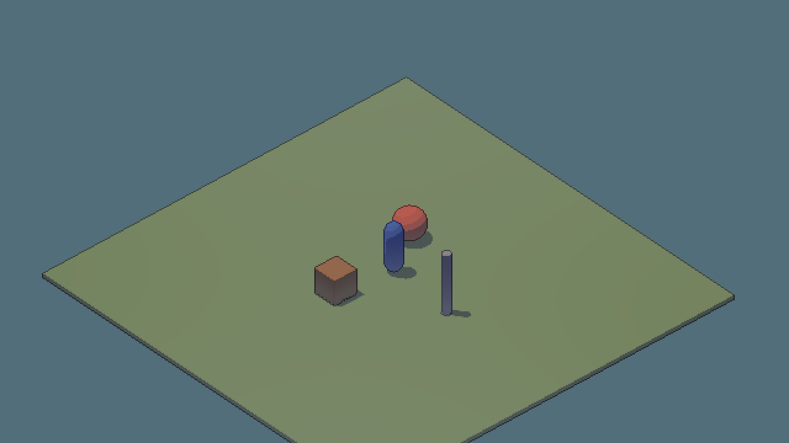
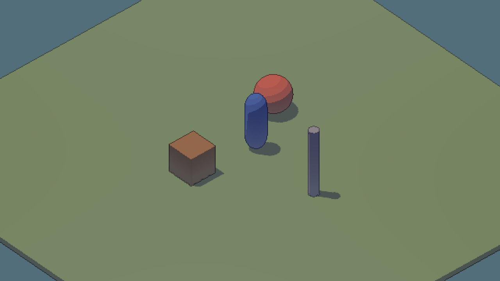
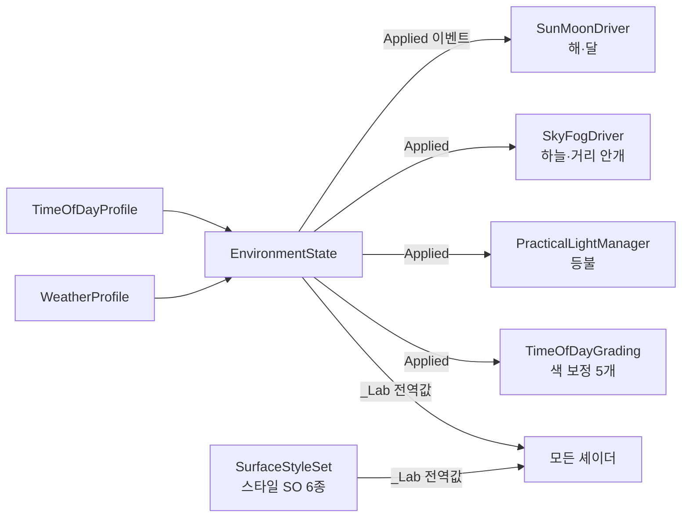

# 🧪 4. 어떻게 만들어졌나

> 이 페이지는 **궁금할 때만** 읽어도 됩니다. 사용하는 데는 필요 없습니다.

## 3D가 도트가 되는 순서

```
3D 장면 ──▶ 툰 셰이더 ──▶ 선화 · 빛줄기 ──▶ 640×360 버퍼 ──▶ 정수 배율 확대
            (4단 명암)      (렌더러 기능)       (포인트 필터)     (서브픽셀 보정)
```

일반 3D 렌더러는 **더 부드럽고 사실적으로** 만드는 데 맞춰져 있습니다 (안티앨리어싱, 시간 누적, 물리 기반 조명).
이 프로젝트는 반대로 **매 프레임 같은 픽셀이 같은 자리에 또렷하게** 찍히는 것이 목표입니다. 그래서 아래 다섯 가지를 직접 만들었습니다.

---

## ① 픽셀 버퍼와 카메라 스냅



| 문제 | 해결 |
|---|---|
| 카메라가 움직이면 배경 픽셀이 자글자글 흔들림 | 카메라를 **텍셀 격자**에 맞춰 놓고 그림 → 정지한 배경은 같은 픽셀에 찍힘 |
| 그러면 스크롤이 1·2텍셀씩 툭툭 끊김 | 격자에서 남은 소수점을 **확대 단계**에서 화면 픽셀 단위로 밀어 줌 |
| 바닥 텍셀 높이가 들쑥날쑥 | 피치를 `asin(round(sin × ppu) / ppu)`로 맞춤 |
| 스크롤 중 버퍼 가장자리가 보임 | 1텍셀 여유를 두고 그 안에서만 밀기 |

## ② 툰 조명



```
빛 에너지 = 표면 방향 × 그림자 × 구름
   ↓ 4단계로 끊기 (.16 / .48 / .78)
색 = 그림자 색(주변광) + 직사광 × 단계
```

- **그림자는 색**입니다. 그림자 쪽은 `Shadow Hue × 주변광`, 직사광은 그 위에 **더하기만** 합니다. (어두운 노을빛 쪽으로 섞으면 오히려 그림자가 밝아짐)
- **등불은 표면 방향만 끊고 거리 감쇠는 부드럽게.** 둘을 같이 끊으면 약한 빛이 사라집니다.
- **횃불 빛 웅덩이**는 URP의 역제곱 대신 Built-in식 `1/(1+25d²/r²)` 감쇠로 크기를 유지합니다.
- 실사 텍스처 물체는 `Semi-real shading blend`로 툰 ↔ GGX 반실사를 섞습니다.

## ③ 물체 ID 선화


1. **ID 패스:** 모든 물체를 오버라이드 셰이더로 다시 그려 물체 ID · 안쪽/바깥 선 세기를 버퍼에 기록
2. **선화 패스:** 이웃 픽셀과 비교해 **물체 경계 > 깊이 > 법선** 순으로 1픽셀 선
3. 바람에 흔들리는 잎도 같은 정점 함수를 써서 선이 따라감

## ④ 기술 모듈

셰이더는 **기술마다 파일 하나**입니다. 표면 셰이더 `SH_SpriteToon`은 모듈을 조합만 합니다.

| 모듈 | 기술 |
|---|---|
| `LabEnvironment` | 시간대 · 날씨 전역값, 구름 그늘 |
| `LabWind` | 나무 · 풀 · 깃발 · 물결 정점 움직임 |
| `LabToonLighting` | 4단 툰 조명, GGX, 횃불 감쇠 |
| `LabWetness` · `LabSnow` | 젖음 · 눈 |
| `LabPuddles` · `LabPlanarReflection` | 웅덩이 · 평면 반사 |
| `LabWater` | 호수 표면 |
| `LabHeightFog` | 높이 안개 |
| `LabCharacterLight` · `LabVisibility` | 캐릭터 림 · 가림 구멍 |

**키워드 규칙**
- 머티리얼 단위 기능(잎 잘라내기, 노멀 맵, 반실사, 웅덩이, 물)은 `shader_feature_local` 키워드 → 쓰지 않는 머티리얼에는 코드가 컴파일되지 않음
- 렌더러마다 다른 값(바람 종류, 캐릭터 조명, 가림 구멍)은 키워드가 아니라 **MaterialPropertyBlock** → 같은 머티리얼을 공유해도 렌더러마다 다르게

## ⑤ 환경 코어



`Apply()` 한 번이면 해 · 하늘 · 등불 · 색 보정 · 모든 셰이더가 같이 바뀝니다.

---

## 렌더러 기능 패스 순서

| 시점 | 패스 | 켜는 컴포넌트 (카메라) |
|---|---|---|
| 투명 물체 뒤 | 벽 뒤 실루엣 (스텐실 + 스캔) | `PlayerVisibility` |
| 투명 물체 뒤 +1 | 픽셀 해상도 빛줄기 (24단계 레이마칭 → 13탭 블러 → 단계 끊기) | `PixelVolumetrics` |
| 후처리 직전 | 물체 ID 선화 (안개 위에 그려 선이 또렷) | `PixelLinework` |

## 날씨가 표면에 닿는 법

| 날씨 값 | 받는 기술 |
|---|---|
| `wetness` (젖음) | 표면 어둡게 · 젖은 하이라이트 · 웅덩이 차오름 · 반사 (젖음 .22 이상) |
| `snowCover` (적설) | 위쪽 면 눈 · 발자국 (40% 이상) · 웅덩이 사라짐 |
| `animationTime` | 바람 · 물결 · 빗방울 파문 (바람은 12fps 계단식) |
| `Daylight` · `Dusk` | 해 · 달 · 등불 · 안개 색 · 색 보정 · 빛줄기 세기 |

## 검증 방법

기술을 **켜고 끈 화면을 픽셀 단위로 비교**합니다. 예: 웅덩이를 끄면 62,644 픽셀이 바뀌어야 통과.
에디터 배치 모드에서 13종을 돌리고, 구조를 바꿀 때마다 조명 캡처의 평균 밝기를 이전과 비교합니다.
