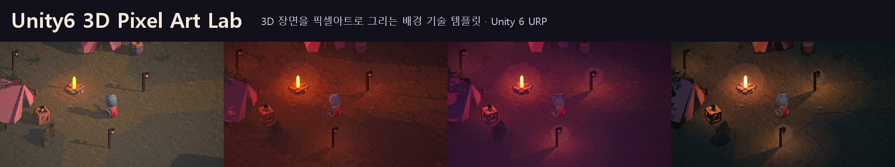

# 🗓 8. 변경 이력

처음부터 지금까지 어떻게 바뀌었는지입니다. 각 단계의 모습은 [갤러리](01-기술-갤러리)의 ①~⑧에 대응합니다.

### v0. 첫 시도 · 블록 모델 (2026-11-01)
- 블록 모델과 픽셀 표면 질감 위주 → 목표와 차이가 커 비교용으로 보존 (`3D-Pixel-Art-Lighting-Study`)

### v1. 스프라이트 연구 · 갤러리 ①
- 툰 조명 4단계, 재질별 기본색 · 그림자 색
- 16bit 물체 ID 선화, 안쪽 · 바깥 선 세기 분리
- 세로 360px · Point 필터 · 정수 확대, 카메라 픽셀 정렬
- 설계한 법선 (나무 · 얼굴 · 망토의 명암 덩어리)
- 횃불: 표면 방향만 단계화, 거리 감쇠는 유지 → 약한 빛이 사라지지 않음

### v2. 탐험 씬 · 갤러리 ②
- 150m 숲 · 야영지 · 호수 · 폐허 · 전망대 (CC0 Kenney · KayKit 기사)
- 이동 · 점프 · 착지 애니메이션, 미니맵, 지역 발견, 물에 빠지면 복귀

### v3. 낮밤 · 날씨 · 갤러리 ③
- 아침 · 정오 · 노을 · 밤, 비 · 눈, 픽셀 정렬 강수 입자
- 나무 · 풀 · 깃발 바람, 물결 · 물가 거품, 젖은 표면 · 눈 쌓임

### v4. 반실사 숲 · 갤러리 ④
- Poly Haven CC0 나무 · 고사리 · 바위 (노멀 · 거칠기 · AO)
- 툰 ↔ 반실사 블렌드, 호수 평면 반사

### v5. 웅덩이 · 반사 · 가독성 · 갤러리 ⑤
- 비 오면 차오르는 웅덩이, 빗방울 파문, 평면 반사, 발 물튀김
- 맵 전체 분포, 젖은 흙 테두리와 마르는 과정
- 눈 발자국, 반사 방향 · 지형 높이 보정
- 캐릭터 림, 앞을 가린 나무 디더 투명화, 벽 뒤 실루엣

### v6. URP 전환 · 카메라 (2026-11-02)
- Built-in → URP (처음 모바일, 같은 날 PC로 변경. HDRP · Unreal 재검토 후 URP 유지)
- 서브픽셀 스크롤 보정으로 카메라 흔들림 해결
- Never's End 스타일 기사: 장비 정리, 16방향 스냅, 12fps 포즈

### v7. 배경 조명 1~5단계 · 갤러리 ⑥ ⑦
- 1단계 PC URP 설정 · 조명 비율 · 픽셀 블룸
- 2단계 생활 조명 랜턴
- 3단계 높이 안개
- 4단계 픽셀 해상도 볼류메트릭
- 5단계 시간대 색 보정, 노을 주홍 → 분홍 → 보라
- 등불 일렁임 (2026-11-03)

### v8. 재사용 템플릿 R0~R5 · 갤러리 ⑧ (2026-11-03 ~ 11-10)
- **R0** 폴더 · 어셈블리 · 이름 규칙 · 레이어
- **R1** 환경 코어 `EnvironmentState` + 시간대 · 날씨 프로필 SO
- **R2** Sprite Toon → 기술 모듈 11개 + 머티리얼 키워드 6개
- **R3** 스타일 SO 6종, `LabCharacter` · `SteppedAnimator` · `WaterBody` · `PixelAtmosphere` Volume, 예제 의존 제거
- **R4** 기술별 테스트 씬 11개 + 자동 검증 (숨은 예제 의존 2개 추가 발견: 웅덩이 높이 하한, 발자국 지면 규칙)
- **R5** [Notion 기술 기록](https://app.notion.com/p/41310d86fdd580a7af9fd1f146aa43a1), README · 위키

> 각 단계 뒤 조명 캡처 평균 밝기를 비교해 화면이 바뀌지 않았는지 확인했습니다 (정오 .339 · 분홍 노을 .14 · 밤 .15).
