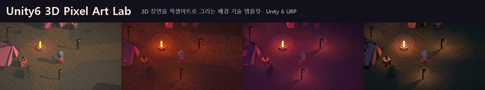
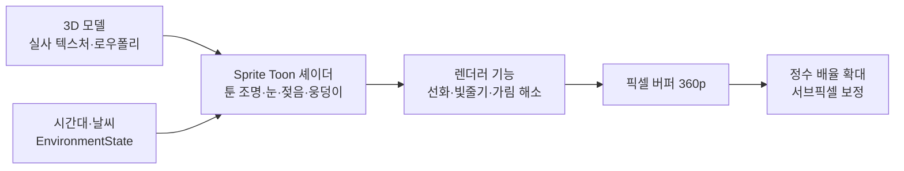

# 🌲 3D 픽셀 배경 기술 가이드

Unity 6 **URP**로 3D 장면을 픽셀아트처럼 그리는 배경 기술 모음입니다.
픽셀화 · 툰 조명 · 눈 · 비 · 웅덩이 · 물 · 안개 같은 기술을 하나씩 만들고, **언제 쓰고 어떻게 관리하는지**까지 기록했습니다.
Unity를 처음 다루는 사람도 따라올 수 있게 **결과 → 사용법 → 원리** 순서로 정리했습니다.

## 👋 처음이라면 여기부터

| 순서 | 페이지 | 읽는 시간 | 이런 분께 |
|:---:|---|:---:|---|
| 1 | [🎨 기술 갤러리](01-기술-갤러리) | 1분 | 어떤 화면을 만들 수 있는지 먼저 보고 싶다 |
| 2 | [🚀 바로 써보기](02-바로-써보기) | 10분 | 씬을 열어 보거나 내 프로젝트에 넣고 싶다 |
| 3 | [🎚 설정값 사전](03-설정값-사전) | 필요할 때 | 원하는 느낌을 내려면 무엇을 바꿔야 하는지 |
| 4 | [🧪 어떻게 만들어졌나](04-어떻게-만들어졌나) | 15분 | 3D가 어떻게 도트가 되는지 궁금하다 |
| 5 | [🧭 기술 선택 가이드](05-기술-선택-가이드) | 15분 | 이 기술을 내 게임에 써야 할지 판단하고 싶다 |
| 6 | [🩹 문제 해결](06-문제-해결) | 필요할 때 | 화면이 이상하게 나온다 |
| 7 | [📓 렌더 파이프라인 결정](07-렌더-파이프라인-결정) | 5분 | PC인데 왜 HDRP가 아니라 URP인지 |
| 8 | [🗓 변경 이력](08-변경-이력) | 5분 | 처음부터 지금까지 무엇이 바뀌었나 |

## ⚡ 한눈에 보는 흐름

## 📌 꼭 알아둘 3가지

1. **3D로 그리고 도트로 정리합니다.** 화면은 약 640×360 버퍼에 그린 뒤 정수 배율로 확대합니다. 그래서 효과도 그 해상도로 계산합니다.
2. **얼마나 · 어떻게 · 어디에를 나눕니다.** 얼마나(시각, 젖음, 적설)는 `EnvironmentState`, 어떻게 보이나(색, 단계, 크기)는 스타일 에셋, 어디에(이 머티리얼에 웅덩이)는 머티리얼 값입니다.
3. **셰이더를 직접 고칠 필요는 없습니다.** 대부분 에셋(SO)과 컴포넌트 값을 바꾸면 됩니다.

## 🛠 환경

| 항목 | 버전 |
|---|---|
| 엔진 | Unity 6000.3.9f1 |
| 렌더 파이프라인 | URP 17.3 (PC: HDR, Forward+, 그림자 4096) |
| 대표 씬 | `Assets/Scenes/Semi-Real-Pixel-Woodland.unity` |
| 기술 테스트 씬 | `Assets/PixelArtLab/Samples/Techniques/Scenes/Technique-*.unity` |
| 기록 | [Notion 기술 템플릿](https://app.notion.com/p/41310d86fdd580a7af9fd1f146aa43a1) |
