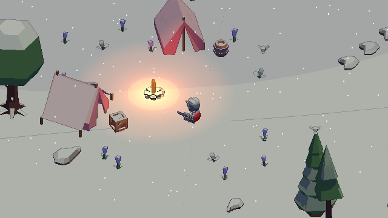

# Unity6-3D-Pixel-Art-Lab

> 배경 제작 기술을 기능별로 구현해 다른 환경 프로젝트에서 재사용하는 것이 목표다. 폴더·어셈블리·이름 규칙은 [프로젝트 규칙](Docs/Conventions.md), 렌더 파이프라인 선택 근거는 [결정 기록](Docs/Render-Pipeline-Decision.md)에 있다.

Unity 6에서 **3D 모델을 2D 픽셀 스프라이트처럼 표현하는 렌더링 연구**입니다.
Never’s End 개발자의 GDC 2026 발표와 Unity 문서를 참고합니다. 원작의 에셋·코드는 사용하지 않습니다.

## 실행

**상세 에셋 비교:** `Assets/Scenes/Semi-Real-Pixel-Woodland.unity`를 열면
Poly Haven CC0 나무·고사리·바위와 노멀·거칠기·AO, 물결·평면 반사를 비교할 수 있습니다.
J 명암 방식, K 노멀 맵, C 반사, M 야영지/호숫가, Tab 해상도 비교.
[구현·출처·조작 안내](Docs/Semi-Real-Woodland.md)

캐릭터 조명·가림 해소: **F5** 림·보조광, **F6** 큰 나무·물체의 컷아웃,
**F7** 벽 뒤 스캔 실루엣 비교. 낮은 푯말은 그대로 유지합니다.
[설정과 검증](Docs/Player-Readability.md)

1. Unity Hub에 이 폴더를 등록하고 **6000.3.9f1**로 엽니다.
2. **Assets/Scenes/Amberwood-Free-Roam.unity**를 열고 Play를 누릅니다.
3. WASD 이동, Shift 달리기, Space 점프. Q/E 회전, 휠 확대, R 야영지 복귀.

## 낮·밤과 날씨

- F1 / F2 / F3 / F4: 아침 / 정오 / 노을 / 밤. L: 시간 자동 흐름.
- 1 / 2 / 3: 맑음 / 비 / 눈. B: 바람, V: 물결, U: 단계적인 캐릭터 회전·애니메이션(초당 12장) 비교.
- 시간대별 Toon 그림자 색, 밤의 횃불, 젖은 표면·눈 쌓임, 픽셀 정렬 강수 입자.
- 물결·잔물결·물가 포말과 나무·풀·깃발의 바람 변형.
- 상세 비교 씬: 적설량 40%부터 눈 발자국 생성. 4초 후부터 흐려져 약 18초에 사라집니다.
- 반사 방향·캐릭터 반사 보정, 태양·달과 가까운 횃불의 그림자 지원.
- 실제 지면 높이로 반사를 투영해 먼 울타리의 접점을 유지하고, 낮은 꽃도 촬영합니다.
- 노을·밤에도 눈 그림자가 밝아지지 않도록 주변광과 직접광을 분리합니다.
- 변형된 화면·그림자·ID·깊이 정보를 맞춰 움직이는 물체의 선화 유지.

[개발자 자료와 구현 문서](Docs/Atmosphere-Research.md) · [환경 검증](Previews/Atmosphere-Verification.txt)

이번 업데이트는 **실행 파일을 빌드하지 않았습니다.** 새 환경 기능은 Unity Play 모드에서 확인하세요.
기존 Windows 실행 파일은 이전 버전입니다.

## 플레이 가능한 탐험 씬

- 약 150m × 150m의 연결된 숲·야영지·호수·폐허·전망대.
- CC0 무료 Kenney 환경 에셋과 KayKit 기사 캐릭터 사용.
- 이동·달리기·점프·낙하·착지 애니메이션, 지형·장애물 충돌, 추적 카메라.
- 미니맵, 5개 지역 발견, 3개 수집물, 물에 빠졌을 때 복귀, 일시정지.
- 기존 Toon·물체별 선화·픽셀 렌더링·횃불 조명 유지.
- Windows 실행 파일: `Builds/Amberwood/Amberwood.exe` (로컬 빌드, Git 제외).

[실행·조작 안내](Docs/Amberwood-Free-Roam.md) · [무료 에셋 출처·라이선스](Docs/Third-Party-Assets.md) · [플레이 검증 결과](Previews/Open-World-Playtest.txt)

맵은 유한한 탐험 프로토타입이며 전투·수영·저장 기능은 포함하지 않습니다.
아래 그래픽 비교 조작은 별도 `3D-Sprite-Rendering-Study.unity` 씬에서 사용합니다.

| 입력 | 기능 |
| --- | --- |
| WASD / 방향키 | 카메라 이동 |
| Q / E | 카메라 회전 |
| 휠 | 정수 픽셀 밀도 변경 |
| T | 단계형 툰 명암 / 연속 명암 |
| O | 한 소스 픽셀 두께 선화 |
| P | 카메라 위치·기울기 픽셀 정렬 |
| Tab | 저해상도 / 기본 해상도 |
| I | 물체 ID별 선화 / 깊이·법선만 사용 |
| G | 물체 ID를 서로 다른 색으로 확인 |
| N | 설계한 법선 / 자동 계산 법선 비교 |
| 1 / 2 / 3 | 전체 / 기본 / 캐릭터 확대 구도 |
| R / H | 구도 초기화 / 안내 숨기기 |

## 세 번째 연구: 물체별 선화와 설계한 명암

- Built-in용 커스텀 툰 조명, 재질별 기본색·그림자 색, 4단계 명암.
- 16bit 물체 ID와 외곽·내부선 강도를 별도 버퍼에 기록합니다.
- 나무·캐릭터·건물을 의미 단위로 묶어 불필요한 내부선을 억제합니다.
- 수목·관목·얼굴·머리카락·망토의 법선 방향을 조정한 메쉬를 저장합니다.
- 기본 세로 360px, 27px/unit, Point 필터, 정수 배율 확대.
- 화면 픽셀 격자에 카메라를 정렬하고 정수 밀도에 맞춰 줌·기울기를 계산.
- 무작위 텍셀 노이즈 대신 넓은 색면과 형상을 사용하는 모델 구성.
- 얼굴·장비를 보강한 캐릭터, 가늘어지는 가지, 잎 덩어리, 관목과 꽃.
- 방향광과 실제 Point Light의 추가 툰 조명 패스로 횃불 주변을 밝힙니다.
- 추가 광원은 표면 명암만 단계화하고 거리 감쇠를 유지해 Toon 모드에서도 주변광이 사라지지 않습니다.
- 기존 Sprite Toon 재질의 `Local Light Strength`로 국소 조명의 반응 세기를 조절할 수 있습니다(기본 1).

[캐릭터 확대](Previews/07-Character-Lighting-Closeup.png) · [물체 ID 확인](Previews/06-Object-Identity-Debug.png) · [기본 법선 비교](Previews/08-Default-Normals-Comparison.png)

법선은 Blender에서 수작업으로 편집한 것이 아니라 스크립트로 방향을 설계한 결과입니다.
렌더링 메쉬의 법선만 바꾸며 별도 그림자용 모델은 아직 사용하지 않습니다.

[두 번째 연구](Previews/04-Before-Art-Direction.png)와 [당시 연속 명암·선화 OFF](Previews/03-Sprite-World-Continuous-No-Lines.png)는 이전 버전 비교용입니다. Standard/PBR 비교는 아닙니다.

원작과 같은 완성도를 달성한 결과가 아니라 핵심 원리를 검증하는 장면입니다.
미구현: Material ID 선화, 물체 단위 앞뒤 정렬, 별도 그림자 수신 형상,
관절 픽셀 정렬, 애니메이션, 원작과 같은 재질별 조명 램프·SSAO.
물체 ID는 현재 선화 제어용이며 기본 3D 깊이 판정을 스프라이트 정렬로 대체하지 않습니다.

설정과 제작 방향은 [렌더링 연구 문서](Docs/Rendering-Research.md)에 정리했습니다.

## 재생성·검증

- `Pixel Art Lab > Build Research-Based Sprite World`: 새 장면과 비교 이미지 생성.
- 장면을 덮어쓰므로 편집한 장면은 다른 이름으로 저장하세요.
- 자동 검증 진입점: `PixelArtLab.Editor.SpriteWorldVerification.Run`.
- 횃불 회귀 검증: `PixelArtLab.Editor.SpriteWorldVerification.RunTorchLighting`.
- [횃불 검증 결과](Previews/Torch-Lighting-Verification.txt): Toon/연속 명암에서 광원 ON/OFF의 화면 차이 비교.
- [검증 결과](Previews/Rendering-Verification.txt): 카메라 정렬, 정수 확대, ID 복원, 선화·법선·광원의 픽셀 변화, 해상도 전환.

## 첫 번째 연구 보존

`Assets/Scenes/3D-Pixel-Art-Lighting-Study.unity`는 블록 모델과 픽셀 표면 질감 위주였던 초기 시도입니다.
목표와 차이가 커 비교용으로 보존합니다. 현재 기본 실행 장면은 세 번째 연구로 갱신했습니다.
