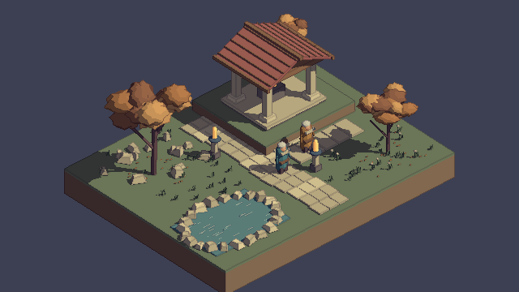

# Unity6-3D-Pixel-Art-Lab

Unity 6에서 **3D 모델을 2D 픽셀 스프라이트처럼 표현하는 렌더링 연구**입니다.
Never’s End 개발자의 GDC 2026 발표와 Unity 문서를 참고합니다. 원작의 에셋·코드는 사용하지 않습니다.

## 실행

1. Unity Hub에 이 폴더를 등록하고 **6000.3.9f1**로 엽니다.
2. **Assets/Scenes/3D-Sprite-Rendering-Study.unity**를 열고 Play를 누릅니다.
3. T / O / P / Tab으로 렌더링 기능을 비교합니다.

| 입력 | 기능 |
| --- | --- |
| WASD / 방향키 | 카메라 이동 |
| Q / E | 카메라 회전 |
| 휠 | 정수 픽셀 밀도 변경 |
| T | 단계형 툰 명암 / 연속 명암 |
| O | 한 소스 픽셀 두께 선화 |
| P | 카메라 위치·기울기 픽셀 정렬 |
| Tab | 저해상도 / 기본 해상도 |
| R / H | 구도 초기화 / 안내 숨기기 |

## 두 번째 연구: 텍스처보다 렌더링

- Built-in용 커스텀 툰 조명, 재질별 기본색·그림자 색, 4단계 명암.
- 깊이·법선 기반 선택적 선화. 원작의 Object ID 기반 선화와는 다릅니다.
- 기본 세로 360px, 21px/unit, Point 필터, 정수 배율 확대.
- 화면 픽셀 격자에 카메라를 정렬하고 정수 밀도에 맞춰 줌·기울기를 계산.
- 무작위 텍셀 노이즈 대신 넓은 색면과 형상을 사용하는 모델 구성.
- 3D 캐릭터, 경사진 지붕, 수목 실루엣, 모서리가 깎인 바위.

[연속 명암·선화 OFF 비교](Previews/03-Sprite-World-Continuous-No-Lines.png)는 같은 셰이더의 명암을 연속값으로 바꾼 화면입니다. Standard/PBR 비교는 아닙니다.

원작과 같은 완성도를 달성한 결과가 아니라 핵심 원리를 검증하는 장면입니다.
미구현: Object/Material ID 선화, 물체 단위 정렬, 별도 그림자 수신 형상, 수작업 법선,
관절 픽셀 정렬, 애니메이션, 다중 광원별 툰 램프, SSAO.
현재 주 방향광 중심이며 추가 Point Light의 조명을 처리하지 않습니다.

설정과 제작 방향은 [렌더링 연구 문서](Docs/Rendering-Research.md)에 정리했습니다.

## 재생성·검증

- `Pixel Art Lab > Build Research-Based Sprite World`: 새 장면과 비교 이미지 생성.
- 장면을 덮어쓰므로 편집한 장면은 다른 이름으로 저장하세요.
- 자동 검증 진입점: `PixelArtLab.Editor.SpriteWorldVerification.Run`.
- [검증 결과](Previews/Rendering-Verification.txt): 카메라 정렬, 정수 확대, 효과별 픽셀 변화, 해상도 전환.

## 첫 번째 연구 보존

`Assets/Scenes/3D-Pixel-Art-Lighting-Study.unity`는 블록 모델과 픽셀 표면 질감 위주였던 초기 시도입니다.
목표와 차이가 커 비교용으로 보존합니다. 현재 기본 실행 장면은 두 번째 연구입니다.
