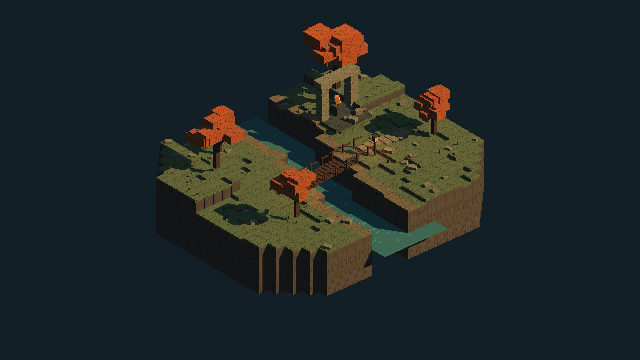

# Unity6-3D-Pixel-Art-Lab

Unity 6에서 3D 공간과 픽셀 아트를 결합하는 그래픽 실험 프로젝트입니다.
Never’s End의 공간감과 픽셀 표현을 참고하며, 게임의 에셋·코드·캐릭터를 사용하지 않습니다.

## 실행

1. Unity Hub에서 이 폴더를 Add project로 등록합니다.
2. Unity **6000.3.9f1**로 엽니다.
3. `Assets/Scenes/3D-Pixel-Art-Lighting-Study.unity`를 열고 Play를 누릅니다.

## 조작

| 입력 | 기능 |
| --- | --- |
| WASD / 방향키 | 카메라 이동 |
| Q / E | 카메라 회전 |
| 마우스 휠 | 확대 / 축소 |
| Tab | 360p 픽셀 렌더링 / 기본 해상도 비교 |
| R | 카메라 초기화 |
| H | 도움말 표시 전환 |

## 제작 방식

- Built-in Render Pipeline과 직교 카메라로 구성한 3D 지형입니다.
- 360p RenderTexture를 Point 필터로 확대하여 화면의 픽셀 크기를 통일합니다.
- 계단식 절벽, 강, 나무다리, 호박색 수목, 폐허와 랜턴을 고정 시드로 생성합니다.
- 16×24 픽셀 캐릭터를 직접 정의하고 카메라를 바라보는 스프라이트로 배치합니다.
- 따뜻한 직사광과 차가운 환경광, 하드 섀도, 거리 안개로 깊이를 표현합니다.
- 외부 에셋이나 유료 패키지 없이 생성한 그래픽 연구용 장면입니다.

`Pixel Art Lab > Rebuild Demonstration Scene`에서 장면과 미리보기를 다시 생성할 수 있습니다.
이 작업은 데모 장면을 덮어쓰므로 수정한 장면은 먼저 다른 이름으로 저장하세요.

현재는 그래픽 프로토타입이며 전투·빙의·환경 시뮬레이션은 포함하지 않습니다.
원작의 전용 렌더러를 재현한 것이 아니라 기본 기능으로 구성한 시각적 출발점입니다.
