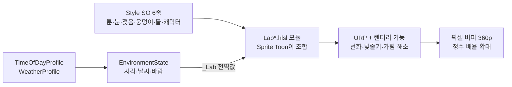

  

  
  
  
  
  

# 🌲 Unity6 3D Pixel Art Lab

Unity 6 URP 기반 **3D 픽셀 배경 기술 연구**.
3D 장면을 저해상도 픽셀 버퍼에 그려, Replaced 같은 디테일한 배경과 Never's End 같은 도트 캐릭터를 섞습니다.
픽셀화 · 눈 쌓임 · 비에 젖음 · 웅덩이 반사 · 안개 같은 배경 기술을 **하나씩 구현하고, 언제 쓰고 어떻게 관리하는지** 기록합니다.

---

## 🎨 Gallery — 발전한 순서

| ① 스프라이트 연구 | ② 탐험 씬 | ③ 날씨 | ④ 반실사 숲 |
|:---:|:---:|:---:|:---:|
|  |  |  |  |
| **⑤ 웅덩이 · 반사** | **⑥ 밤 등불** | **⑦ 노을 3색** | **⑧ 기술 테스트 씬 (최신)** |
|  |  |  |  |

⑥ ⑦ 은 같은 야영지를 시간만 바꿔 찍은 장면입니다 → [갤러리 자세히](https://github.com/JiwonEnv/Unity6-3D-Pixel-Art-Lab/wiki/01-기술-갤러리)

---

## 🧪 Techniques

| 기술 | 설명 |
|---|---|
| 🟫 픽셀 카메라 | 360p 버퍼 + 정수 배율 확대, 텍셀 격자 스냅, 서브픽셀 스크롤 보정 |
| 🌗 툰 조명 | 광원마다 4단 밴드, 그림자는 색으로, 횃불은 Built-in식 빛 웅덩이 |
| ✏️ 선화 | 물체 ID 버퍼로 물체 경계 > 깊이 > 법선 순 1픽셀 선 |
| 🌬 바람 | 나무 · 풀 · 깃발 · 물결 정점 움직임, 12fps 계단식 시간 |
| 🌧 젖음 | 비가 오면 어두워지고 젖은 하이라이트, 그친 뒤 천천히 마름 |
| ❄️ 눈 | 위를 향한 면에 4단계로 쌓임 + 사라지는 발자국 |
| 💧 웅덩이 | 고정된 자리에 차오르는 웅덩이, 젖은 흙, 빗방울 파문, 평면 반사, 발 물튀김 |
| 🌊 물 | 물결 · 반짝임 · 물가 거품 · 프레넬 반사 (`WaterBody`) |
| 🏮 생활 조명 | 낮밤 등불, 계단식 일렁임, 가까운 4개만 그림자 |
| 🌫 대기 | 높이 안개 · 픽셀 해상도 빛줄기 · 시간대 색 보정 · 구역별 Volume |
| 🧍 캐릭터 가독성 | 림 · 반사광, 앞을 가린 나무 디더 투명화, 벽 뒤 실루엣, 12fps 포즈 |

---

## ⚡ Pipeline

| 단계 | 하는 일 | 도구 |
|---|---|---|
| 🎥 Render | 3D를 픽셀 버퍼에 그리고 정수 배율로 확대 | URP · `ExplorationCamera` |
| 🧪 Shade | 기술마다 HLSL 모듈 하나, 표면 셰이더가 조합 | HLSL · `shader_feature_local` |
| 🎚 Tune | 시간대 · 날씨 · 기술별 스타일을 에셋으로 조절 | ScriptableObject · URP Volume |
| 🤖 Verify | 기술을 켜고 끈 화면을 픽셀 단위로 비교 | C# 에디터 배치 모드 |

---

## 📖 Docs

| | 페이지 | 내용 |
|:---:|---|---|
| 🏠 | [Wiki Home](https://github.com/JiwonEnv/Unity6-3D-Pixel-Art-Lab/wiki) | 처음이라면 여기부터 |
| 🎨 | [기술 갤러리](https://github.com/JiwonEnv/Unity6-3D-Pixel-Art-Lab/wiki/01-기술-갤러리) | 시간대 · 기술별 화면 |
| 🚀 | [바로 써보기](https://github.com/JiwonEnv/Unity6-3D-Pixel-Art-Lab/wiki/02-바로-써보기) | 씬 열기 · 조작 · 내 프로젝트로 옮기기 |
| 🎚 | [설정값 사전](https://github.com/JiwonEnv/Unity6-3D-Pixel-Art-Lab/wiki/03-설정값-사전) | 스타일 · 프로필 · 머티리얼 값과 추천값 |
| 🧪 | [어떻게 만들어졌나](https://github.com/JiwonEnv/Unity6-3D-Pixel-Art-Lab/wiki/04-어떻게-만들어졌나) | 픽셀 버퍼 · 툰 조명 · 모듈 구조 |
| 🧭 | [기술 선택 가이드](https://github.com/JiwonEnv/Unity6-3D-Pixel-Art-Lab/wiki/05-기술-선택-가이드) | 언제 쓰고 언제 안 쓰나 · 장단점 · 관리 |
| 🩹 | [문제 해결](https://github.com/JiwonEnv/Unity6-3D-Pixel-Art-Lab/wiki/06-문제-해결) | 증상별 원인과 해결 |
| 📓 | [렌더 파이프라인 결정](https://github.com/JiwonEnv/Unity6-3D-Pixel-Art-Lab/wiki/07-렌더-파이프라인-결정) | PC인데 HDRP 대신 URP를 고른 이유 |
| 🗓 | [변경 이력](https://github.com/JiwonEnv/Unity6-3D-Pixel-Art-Lab/wiki/08-변경-이력) | 스프라이트 연구 → 재사용 템플릿 |

프로젝트 규칙 전체: [Conventions.md](Docs/Conventions.md) · 배경 조명 설계: [Background-Lighting-Design.md](Docs/Background-Lighting-Design.md)

---

## 🛠 Tech Stack

| 분야 | 사용 |
|---|---|
| 🎮 Engine | Unity 6000.3.9f1 · URP 17.3 (HDR, Forward+, PC) |
| 🧪 Shading | HLSL 기술 모듈 · `shader_feature_local` 키워드 · MaterialPropertyBlock · Override Shader |
| 🎥 Rendering | ScriptableRendererFeature · RenderGraph (선화 · 볼류메트릭 · 가림 해소 패스) |
| 🎚 Data | ScriptableObject 프로필 · 스타일 · URP Volume 오버라이드 |
| 🤖 Automation | C# 에디터 스크립트 — 씬 생성 · 마이그레이션 · 픽셀 비교 검증 (배치 모드) |
| 🌐 Workflow | Git · GitHub Wiki · Notion 기술 기록 |

> 참고: Never's End 개발자의 GDC 2026 발표와 Unity 문서를 참고했습니다. 원작의 에셋 · 코드는 쓰지 않습니다. 외부 에셋 출처는 [Third-Party-Assets.md](Docs/Third-Party-Assets.md).
